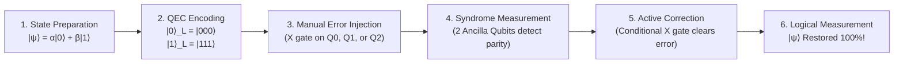

# 🚀 Quantum Error Correction (QEC) Hackathon Action Plan

## 📌 Project Overview
Build a noise-resilient quantum circuit using **Qiskit** that:
1. Encodes a logical quantum state.
2. Injects errors manually (e.g., bit-flip $X$ error on any qubit).
3. Adds an active error-correction stage using ancilla qubits and conditional logic to identify and clear the error.
4. Compares protected vs. unprotected circuits under both manual errors and realistic noise models.
5. Evaluates performance trade-offs (fidelity, qubit count, circuit depth, and compute overhead).

---

## 🏗️ 1. Circuit Architecture (Step-by-Step Flow)



### Detailed Circuit Breakdown:
* **Qubits Needed**: 
  - **3 Data Qubits** ($q_0, q_1, q_2$): Store the logical state $|\psi\rangle_L$.
  - **2 Ancilla Qubits** ($a_0, a_1$): Measure syndromes (parities) without collapsing the quantum superposition.
  - **Classical Bits**: 2 bits for syndrome readout + 1 (or 3) bits for final logical readout.

---

## 🎯 2. How the Error Correction Works

### Step A: Encoding (3-Qubit Repetition Code)
- Start with input state $|\psi\rangle = \alpha|0\rangle + \beta|1\rangle$ on $q_0$.
- Apply CNOT from $q_0 \to q_1$ and $q_0 \to q_2$.
- Result: Logical state $|\psi\rangle_L = \alpha|000\rangle + \beta|111\rangle$.

### Step B: Manual Error Injection
- We can manually inject an error gate (e.g., $X$ gate = bit flip) on any qubit:
  - Error on $q_0 \implies \alpha|100\rangle + \beta|011\rangle$
  - Error on $q_1 \implies \alpha|010\rangle + \beta|101\rangle$
  - Error on $q_2 \implies \alpha|001\rangle + \beta|110\rangle$
  - No error $\implies \alpha|000\rangle + \beta|111\rangle$

### Step C: Non-Destructive Syndrome Extraction (Detection)
- We use 2 ancilla qubits initialized to $|0\rangle$:
  - $a_0$ measures parity between $q_0$ and $q_1$ (via CNOTs from $q_0 \to a_0$ and $q_1 \to a_0$).
  - $a_1$ measures parity between $q_1$ and $q_2$ (via CNOTs from $q_1 \to a_1$ and $q_2 \to a_1$).
- Measure ancilla qubits into classical register $S = [s_1, s_0]$.

### Step D: Syndrome Lookup Table & Active Correction
| Syndrome ($s_1 s_0$) | Parity Condition | Detected Error Location | Correction Applied |
| :---: | :---: | :---: | :---: |
| `00` | $q_0 = q_1$, $q_1 = q_2$ | No Error | No operation |
| `01` | $q_0 \neq q_1$, $q_1 = q_2$ | Error on $q_0$ | Apply $X$ on $q_0$ |
| `10` | $q_0 = q_1$, $q_1 \neq q_2$ | Error on $q_2$ | Apply $X$ on $q_2$ |
| `11` | $q_0 \neq q_1$, $q_1 \neq q_2$ | Error on $q_1$ | Apply $X$ on $q_1$ |

Using Qiskit's dynamic circuit features (`if_test`), we apply the corresponding $X$ correction automatically!

---

## 📊 3. Mapping to Hackathon Tasks (1 to 8)

| Task | Hackathon Requirement | Our Implementation |
| :--- | :--- | :--- |
| **Task 1 & 2** | Hardware features & instability factors | Explain $T_1$ (relaxation), $T_2$ (dephasing), 2-qubit CNOT gate error rates (~10x single qubit), crosstalk, readout error. |
| **Task 3** | Small representative circuit | State preparation: Superposition state $|+\rangle = \frac{|0\rangle + |1\rangle}{\sqrt{2}}$ or arbitrary state $|\psi\rangle$. |
| **Task 4** | Qiskit Noise Model | `NoiseModel` with depolarizing noise, thermal relaxation, and readout errors via `qiskit_aer.noise`. |
| **Task 5** | Unprotected baseline | 1-qubit circuit with same error; verify output state degradation. |
| **Task 6** | QEC Scheme implementation | 3-qubit bit-flip code with ancilla syndrome extraction & dynamic feedforward correction. |
| **Task 7** | Protected vs Unprotected comparison | Run simulations with manual error (0% vs 100% recovery) and parametric noise sweep $p \in [0, 0.25]$ showing the pseudo-threshold curve! |
| **Task 8** | Trade-off analysis | Quantitative table & charts: Qubit count (5 vs 1), Circuit depth, CNOT count, Runtime overhead. |

---

## 📁 4. Deliverables & File Structure

We will create a clean subfolder: `quantum_qec/`
```
quantum_qec/
├── 1_manual_qec_demo.py     # Clean demo: inject error on q0/q1/q2 -> ancilla detects -> automatically fixes!
├── 2_noise_model_study.py   # Realistic Qiskit Aer noise model & baseline vs protected comparison
├── 3_benchmark_plots.py     # Generates publication-quality charts (Fidelity vs Noise, Trade-offs)
├── circuit_diagrams/        # High-res exported circuit diagrams
└── HACKATHON_REPORT.md      # Ready-made presentation script, answers to all 8 tasks, Q&A for judges
```

---

## ⚡ 5. Execution Steps

1. **Step 1: Code the Manual QEC Circuit**
   - Implement the 3 data qubits + 2 ancilla qubits circuit.
   - Test each case: error on $q_0$, error on $q_1$, error on $q_2$, and no error.
   - Print state vectors / counts confirming 100% recovery.

2. **Step 2: Compare Protected vs. Unprotected**
   - Unprotected circuit with error $\implies$ result flips (Fidelity drops to 0.0).
   - Protected circuit with error $\implies$ result recovered (Fidelity = 1.0).

3. **Step 3: Add Realistic Noise & Benchmark Sweep**
   - Sweep depolarizing error $p$ from $0.001$ to $0.20$.
   - Calculate state fidelity and plot the crossover curve.

4. **Step 4: Generate Trade-off Matrix & Report**
   - Table comparing Qubits, Gates, Depth, and Fidelity Gain.
   - Comprehensive documentation for your judges and hackathon pitch.
